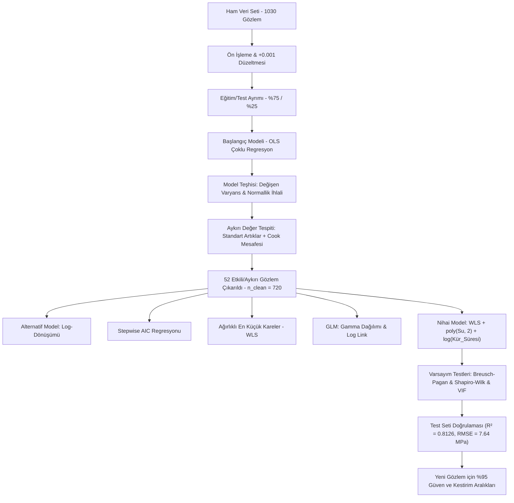
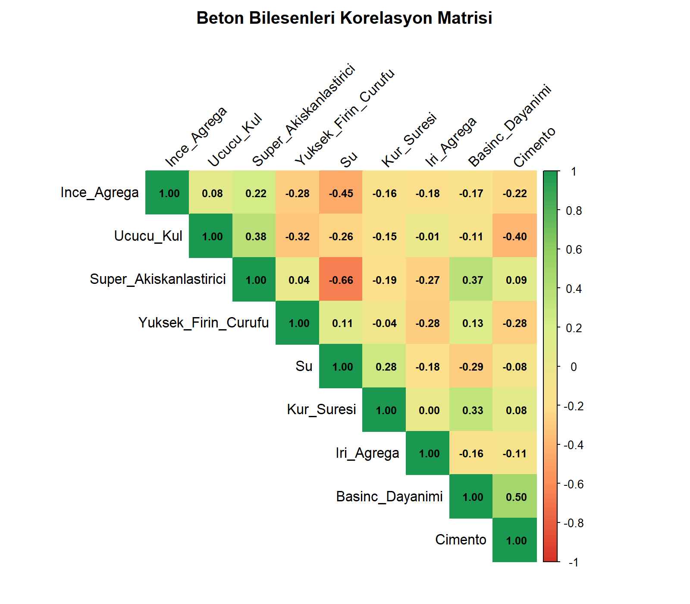
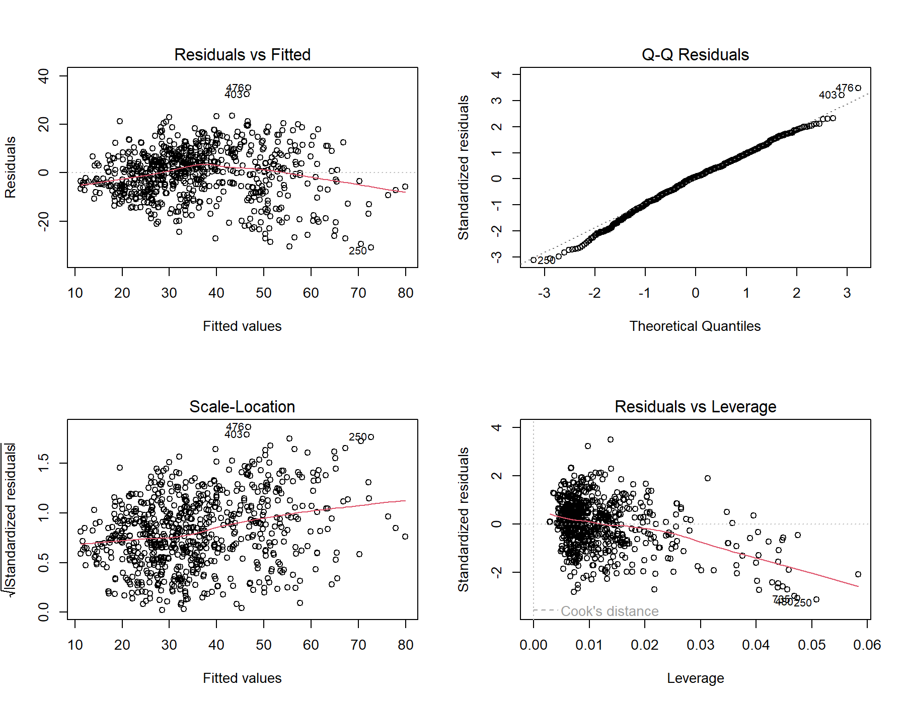
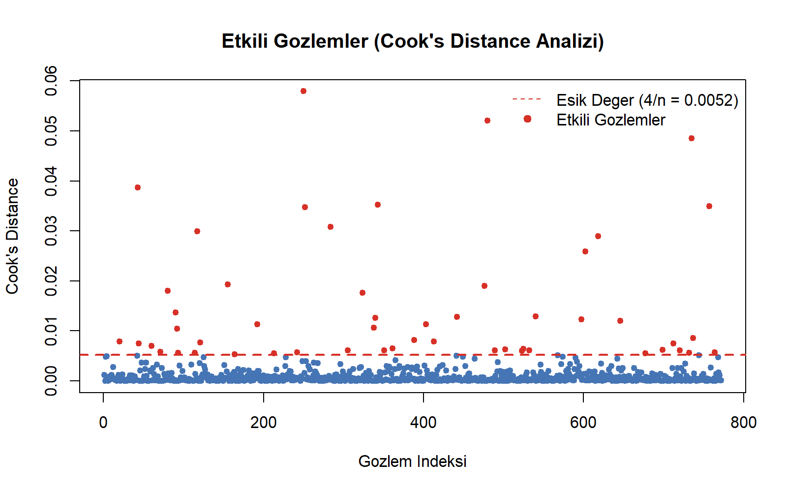
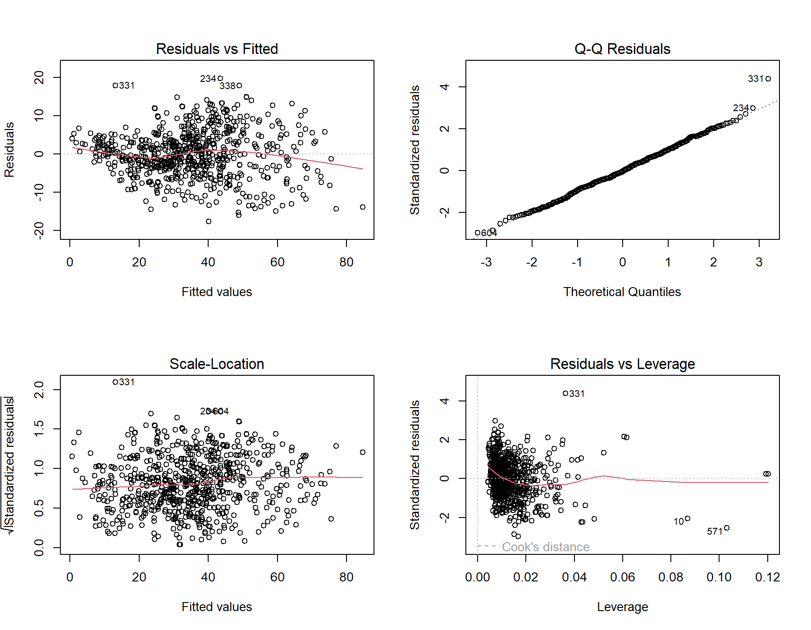
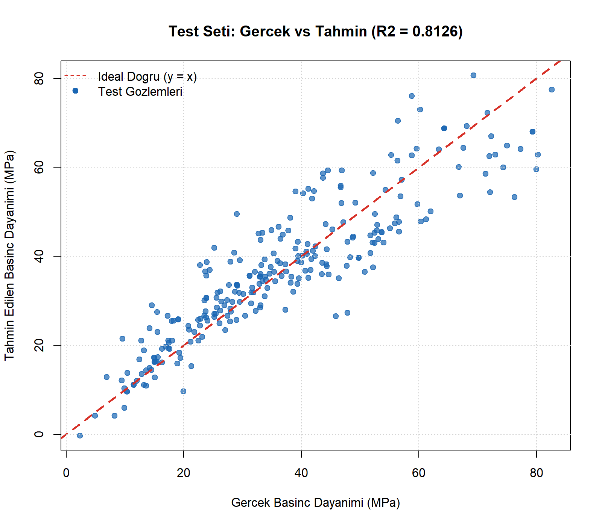
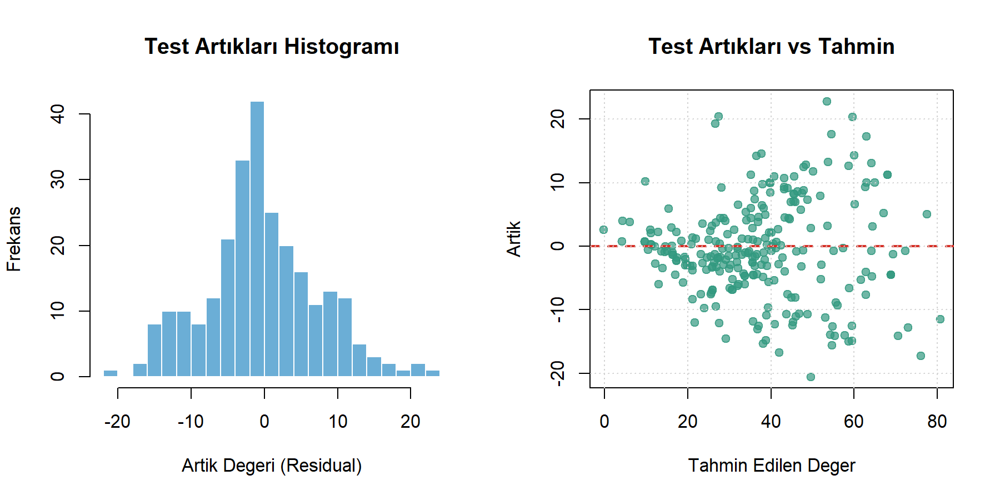

# 🏗️ Beton Basınç Dayanımı Tahmini ve Regresyon Modellemesi
### Concrete Compressive Strength Prediction & Advanced Regression Modeling

[](https://www.r-project.org/)
[](LICENSE)
[](https://www.kaggle.com/datasets/ainalirham/mutubeton/data)
[](#-model-karşılaştırma-tablosu)
[](#-test-seti-performansı)
[](#-proje-ekibi)

---

## 📌 Proje Özeti (Project Overview)

İnşaat ve malzeme mühendisliğinde betonun **basınç dayanımı (*Compressive Strength*)**, bir yapının deprem güvenliği, dayanıklılığı ve taşıma kapasitesi açısından en kritik parametredir. Geleneksel yöntemlerde beton basınç dayanımının belirlenmesi, numunelerin 28 gün boyunca kür havuzlarında bekletilmesini ve ardından kırım preslerinde kırılarak tahribatlı teste tabi tutulmasını gerektirir. Bu durum zaman kaybına, yüksek malzeme maliyetine ve gecikmelere yol açar.

Bu çalışmada, **Dokuz Eylül Üniversitesi Regresyon Analizi** kapsamında; beton bileşenleri (çimento, su, cüruf, uçucu kül, kimyasal katkı, ince ve kaba agrega) ve kürlenme süresi kullanılarak nihai basınç dayanımını yüksek doğrulukla öngören **ileri regresyon modelleri** geliştirilmiştir. 

Projede klasik En Küçük Kareler (OLS) yönteminin varsayım ihlalleri saptanmış; aykırı değer eliminasyonu, **Ağırlıklı En Küçük Kareler (WLS - Weighted Least Squares)**, Box-Cox benzeri parametrik dönüşümler, polinomik terimler ve Genelleştirilmiş Doğrusal Modeller (GLM) uygulanarak **$R^2 = 0.8679$** ve test verisi üzerinde **$R^2 = 0.8126$** açıklayıcılık düzeyine ulaşılmıştır.

---

## 👥 Proje Ekibi (Authors)

Bu çalışma Dokuz Eylül Üniversitesi Regresyon Analizi dersi kapsamında aşağıdaki ekip tarafından hazırlanmıştır:

- **Ayşenur Altınkaya**
- **Gökhan Tanrıöven**
- **Giray Baysal**
- **Kaan Boztaş** ([@kaanboztas](https://github.com/kaanboztas))

---

## 📂 Proje Dizin Yapısı (Repository Structure)

```text
Concrete-Strength-Prediction-and-Regression-Modeling/
│
├── data/
│   ├── Beton1.xlsx                  # Ham Excel veri seti (1030 gözlem, 9 değişken)
│   ├── concrete_data.csv            # GitHub ve açık kaynak uyumlu CSV veri seti
│   └── README.md                    # Değişken sözlüğü, birimler ve veri seti açıklaması
│
├── scripts/
│   ├── analysis.R                   # Uçtan uca eksiksiz R analiz ve modelleme betiği
│   └── install_packages.R           # Bağımlı R paketlerini kontrol edip kuran betik
│
├── figures/                         # Analiz betiği tarafından üretilen yüksek çözünürlüklü grafikler
│   ├── 01_correlation_matrix.png
│   ├── 02_initial_model_diagnostics.png
│   ├── 03_cooks_distance.png
│   ├── 04_final_model_diagnostics.png
│   ├── 05_actual_vs_predicted.png
│   └── 06_test_residuals_distribution.png
│
├── presentation/
│   └── regresyon_projesi_sunum_ve_kodlar.pdf  # Proje sunumu ve çalışma raporu
│
├── .gitignore                       # R, RStudio ve işletim sistemi önbellek kuralları
├── LICENSE                          # MIT Açık Kaynak Lisansı
└── README.md                        # Kapsamlı proje dokümantasyonu
```

---

## 🧱 Veri Seti ve Değişkenler (Dataset & Variables)

Veri seti **1030 farklı beton karışım deneyini** ve 9 nicel değişkeni içermektedir:

| Değişken (R Kodu) | Orijinal İsim | Açıklama | Birim |
| :--- | :--- | :--- | :--- |
| **`Basinc_Dayanimi`** | Compressive Strength | Betonun nihai basınç dayanımı (**Hedef / Bağımlı**) | $MPa$ |
| **`Cimento`** | Cement | Karışımdaki çimento miktarı | $kg / m^3$ |
| **`Yuksek_Firin_Curufu`** | Blast Furnace Slag | Yüksek fırın cürufu miktarı | $kg / m^3$ |
| **`Ucucu_Kul`** | Fly Ash | Uçucu kül katkı miktarı | $kg / m^3$ |
| **`Su`** | Water | Karışımdaki su miktarı | $kg / m^3$ |
| **`Super_Akiskanlastirici`**| Superplasticizer | Kimyasal süper akışkanlaştırıcı miktarı | $kg / m^3$ |
| **`Iri_Agrega`** | Coarse Aggregate | Kaba agrega (kırma taş/çakıl) miktarı | $kg / m^3$ |
| **`Ince_Agrega`** | Fine Aggregate | İnce agrega (kum vb.) miktarı | $kg / m^3$ |
| **`Kur_Suresi`** | Age | Betonun test tarihine kadar geçen kürlenme süresi | Gün ($1 - 365$) |

> **Ön İşleme Notu:** Logaritmik dönüşümlerde sıfır ($0$) bileşen değerlerinin tanımsızlık ($\log 0 = -\infty$) üretmesini önlemek için tüm değişkenlere $+0.001$ sabiti eklenmiştir.

---

## 🔄 Metodoloji ve İş Akışı (Methodology Workflow)



---

## 📈 Keşifsel Veri Analizi ve Korelasyon

Veri setindeki değişkenler arası ilişkileri incelemek amacıyla korelasyon matrisi hesaplanmış ve görselleştirilmiştir:

<p align="center">
  
</p>

- **Çimento ile Dayanım Arasında Pozitif Güçlü İlişki:** Çimento miktarı arttıkça betonun basınç dayanımı belirgin şekilde yükselmektedir ($r \approx 0.50$).
- **Kür Süresinin Belirleyiciliği:** Kür süresi arttıkça hidratasyon reaksiyonları tamamlandığından dayanım logaritmik olarak artmaktadır.
- **Su/Çimento Etkisi:** Aşırı su miktarının dayanımı olumsuz etkilediği, akışkanlaştırıcı katkıların ise su ihtiyacını düşürerek dayanımı artırdığı gözlenmiştir.

---

## 🔬 Modelleme Süreci ve Adımları

### 1. Başlangıç Modeli (OLS) ve Varsayım İhlalleri
Eğitim setinde ($n = 772$) kurulan ilk çoklu doğrusal regresyon modeli $R^2 = 0.6216$ değerine ulaşmıştır. Ancak model tanı grafikleri incelendiğinde:
- **Değişen Varyans (Heteroscedasticity):** Artık varyansı fitted değerler arttıkça artmaktadır ($p_{BP} < 0.05$).
- **Normallik İhlali:** Q-Q grafiğinde uç kuyruklarda sapmalar mevcuttur ($p_{Shapiro} < 0.05$).
- **Anlamsız Değişkenler:** İnce agrega değişkeni istatistiksel olarak anlamsız kalmıştır ($p = 0.0629$).

<p align="center">
  
</p>

### 2. Aykırı ve Etkili Gözlem Analizi (Outlier & Influence Analysis)
Regresyon katsayılarını tek başına saptıran aykırı ve yüksek kaldıraçlı gözlemleri tespit etmek için iki ölçüt birleştirilmiştir:
1. **Standartlaştırılmış Artıklar ($|r| > 3$):** 4 gözlem saptandı.
2. **Cook's Distance ($D_i > \frac{4}{n} \approx 0.00518$):** 52 gözlem saptandı.

<p align="center">
  
</p>

Bu iki kümenin birleşimiyle **52 etkili gözlem** eğitim kümesinden elenmiş ve temiz eğitim kümesi ($n_{clean} = 720$) elde edilmiştir.

### 3. Alternatif ve İyileştirme Modelleri
- **Alternatif Model ($\log(Y)$):** Hedef değişkene logaritmik dönüşüm uygulanmış ($R^2 = 0.6532$), ancak heteroskedasite sorunu çözülememiştir.
- **Stepwise Regresyon (AIC):** Sabit modelden tüm değişkenli modele çift yönlü arama yapılmış ($R^2 = 0.7443$), ancak artıklar normallik ve varyans homojenliği sağlamamıştır.
- **Ağırlıklı En Küçük Kareler (WLS):** Hata varyansı $\text{Var}(e_i) = f(\hat{Y}_i)$ olarak modellenmiş ve $w_i = 1 / \hat{\sigma}_i^2$ ağırlıkları atanmıştır ($R^2 = 0.7713$). Değişen varyans problemi çözülmüştür ($p = 0.9255$).
- **GLM (Gamma Dağılımı & Log Link):** Çarpık dağılımlar için genelleştirilmiş doğrusal model denenmiştir ($AIC = 112.14$, $RMSE = 44.92$).

### 4. Nihai Model (Final WLS Model)
Beton teknolojisindeki fizikokimyasal etkileşimler göz önüne alınarak:
- **Su miktarının doğrusal olmayan etkisi** ikinci dereceden ortogonal polinomla (`poly(Su, 2)`),
- **Kür süresinin logaritmik doygunluk etkisi** (`log(Kür_Süresi)`) ile modele eklenmiş,
- **WLS ağırlıkları** ile katsayılar tahmin edilmiştir.

$$\begin{aligned}
\text{Basınç\_Dayanımı} = & \;\beta_0 + \beta_1(\text{Çimento}) + \beta_2(\text{Cüruf}) + \beta_3(\text{Kül}) \\
& + \beta_4(\text{Su}) + \beta_5(\text{Su}^2) + \beta_6(\text{Süper\_Akışkanlaştırıcı}) \\
& + \beta_7(\text{İri\_Agrega}) + \beta_8(\text{İnce\_Agrega}) + \beta_9\ln(\text{Kür\_Süresi}) + \varepsilon_i
\end{aligned}$$

---

## 📊 Model Karşılaştırma Tablosu

| Model | $R^2$ | Düzeltilmiş $R^2$ | Eğitim RMSE | AIC | Breusch-Pagan ($p$) | Shapiro-Wilk ($p$) | Durum |
| :--- | :---: | :---: | :---: | :---: | :---: | :---: | :---: |
| **Başlangıç OLS (Ham)** | 0.6216 | 0.6177 | 10.24 | 5772.1 | $1.42 \times 10^{-11}$ | $2.14 \times 10^{-8}$ | Varsayımlar İhlal |
| **Alternatif Model ($\log Y$)** | 0.6532 | 0.6493 | 19.14 | 427.4 | $2.93 \times 10^{-5}$ | $6.33 \times 10^{-16}$ | Normallik Red |
| **Stepwise Model (AIC)** | 0.7443 | 0.7421 | 10.64 | 5085.5 | $5.09 \times 10^{-14}$ | $0.0340$ | Heteroskedasite Var |
| **WLS Modeli** | 0.7713 | 0.7688 | 11.28 | 5008.3 | $0.9255$ | $5.82 \times 10^{-6}$ | Normallik Red |
| **GLM (Gamma Log-Link)** | — | — | 44.92 | 112.1 | — | — | Yüksek RMSE |
| 🏆 **WLS Final Model** | **0.8679** | **0.8662** | **7.12** | **4615.1** | **0.9217** (Homojen ✅) | **0.1366** (Normal ✅) | **Tüm Varsayımlar Sağlandı** |

---

## ✅ Nihai Modelin Varsayım Kontrolleri

Nihai modelin geçerliliği resmi hipotez testleri ve tanı grafikleriyle kanıtlanmıştır:

<p align="center">
  
</p>

1. **Varyans Homojenliği (Breusch-Pagan Testi):** $p = 0.9217 > 0.05$. Hata varyansı sabittir (Homoskedasite sağlandı).
2. **Normallik Varsayımı (Shapiro-Wilk Testi):** $p = 0.1366 > 0.05$. Artıklar $N(0, \sigma^2)$ normal dağılımına uymaktadır.
3. **Çoklu Doğrusal Bağlantı (VIF Analizi):** Tüm değişkenler için $GVIF^{1/(2\cdot Df)} < 3$ olup, kritik eşik ($10$) aşılmamıştır; çoklu bağlantı sorunu yoktur.
4. **Katsayı Anlamlılığı:** Modeldeki tüm parametreler istatistiksel olarak anlamlıdır ($p < 0.001$, Süper Akışkanlaştırıcı $p = 0.028$).

---

## 🎯 Test Seti Performansı (Test Set Validation)

Model eğitim kümesine aşırı öğrenme (*overfitting*) yapmamış, daha önce hiç görmediği **258 test gözlemi** üzerinde üstün başarı sergilemiştir:

- **Test $R^2$:** **$0.8126$** (%81.26 açıklanan varyans)
- **Test RMSE:** **$7.6441\ MPa$**
- **Test MAE:** **$5.8668\ MPa$**

<p align="center">
  
  
</p>

---

## 🔮 Yeni Bir Gözlem için Örnek Tahmin ve Aralıklar

Örnek bir beton karışım reçetesi için modelin tahmin performansı ve belirsizlik sınırları hesaplanmıştır:

### Girdi Karışım Değerleri:
- **Çimento:** $281\ kg/m^3$
- **Yüksek Fırın Cürufu:** $73\ kg/m^3$
- **Uçucu Kül:** $54\ kg/m^3$
- **Su:** $181\ kg/m^3$
- **Süper Akışkanlaştırıcı:** $6\ kg/m^3$
- **İri Agrega:** $972\ kg/m^3$
- **İnce Agrega:** $773\ kg/m^3$
- **Kür Süresi:** $45\text{ gün}$

### Tahmin Sonuçları:
- **Nokta Tahmini (Ortalama Dayanım):** **$40.43\ MPa$**
- **%95 Güven Aralığı (*Confidence Interval* - Ortalama İçin):** **$[39.78,\; 41.08]\ MPa$**
- **%95 Kestirim Aralığı (*Prediction Interval* - Tekil Gözlem İçin):** **$[38.80,\; 42.06]\ MPa$**

---

## 🚀 Kurulum ve Çalıştırma Rehberi

Projeyi yerel ortamınızda klonlayıp çalıştırmak için aşağıdaki adımları izleyebilirsiniz:

### 1. Depoyu Klonlayın
```bash
git clone https://github.com/kaanboztas/Concrete-Strength-Prediction-and-Regression-Modeling.git
cd Concrete-Strength-Prediction-and-Regression-Modeling
```

### 2. Gerekli R Paketlerini Kurun
Terminal veya R konsolunda kurulum betiğini çalıştırın:
```bash
Rscript scripts/install_packages.R
```
*Gerekli kütüphaneler:* `readxl`, `dplyr`, `corrplot`, `car`, `lmtest`, `zoo`.

### 3. Analizi ve Grafik Üretimini Başlatın
```bash
Rscript scripts/analysis.R
```
Betiğin çalışması tamamlandığında tüm model metrikleri konsola yazdırılacak ve üretilen tüm grafikler otomatik olarak `figures/` dizinine kaydedilecektir.

---

## 💡 Gelecek Çalışmalar ve Öneriler

1. **Alan Bilgisine Dayalı Türetilmiş Değişkenler:** Beton teknolojisinde en önemli parametrelerden biri olan **Su / Bağlayıcı Oranı** ($\frac{Su}{\text{Çimento} + \text{Cüruf} + \text{Kül}}$) formülü yeni bir bağımsız değişken olarak eklenebilir.
2. **Makine Öğrenmesi Kıyaslaması:** Random Forest, XGBoost ve Destek Vektör Regresyonu (SVR) gibi doğrusal olmayan algoritmalar ile parametrik modeller karşılaştırılabilir.
3. **Web Uygulaması / Arayüzü:** İnşaat mühendislerinin karışım oranlarını girerek anlık basınç dayanımı tahmini alabileceği interaktif bir R Shiny / Python Streamlit arayüzü entegre edilebilir.

---

## 📚 Kaynakça ve Referanslar

1. **Yeh, I-C. (1998).** *"Modeling of strength of high-performance concrete using artificial neural networks."* Cement and Concrete Research, 28(12), 1797-1808.
2. **UCI Machine Learning Repository:** [Concrete Compressive Strength Data Set](https://archive.ics.uci.edu/ml/datasets/concrete+compressive+strength)
3. **Kaggle Açık Kaynak Veri Seti:** [Mutu Beton Dataset (Aina Ilrham)](https://www.kaggle.com/datasets/ainalirham/mutubeton/data)
4. **Dokuz Eylül Üniversitesi (DEÜ):** Regresyon Analizi Ders Notları ve Uygulama Kaynakları.

---

<p align="center">
  Lisans: <a href="LICENSE">MIT Lisansı</a> © 2024 Kaan Boztaş & Proje Ekibi
</p>
